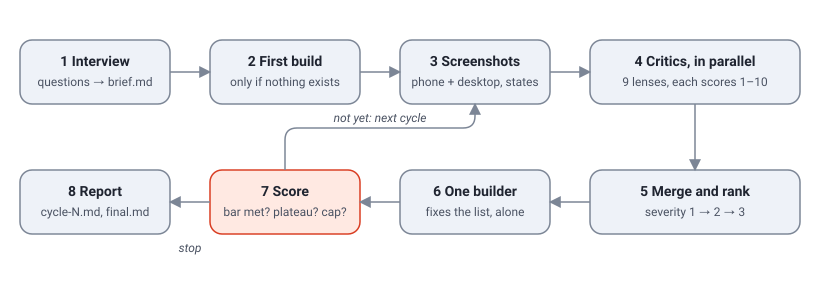
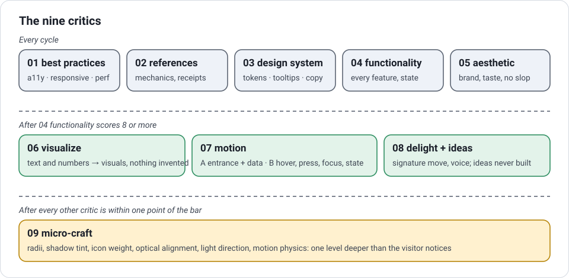
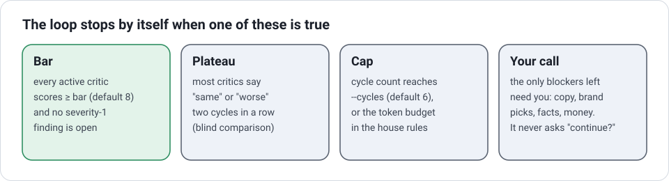

# uiux

**One command. It asks you what you want. Then it builds, checks, and fixes your page until the page is good.**

uiux is a skill for [Claude Code](https://claude.com/claude-code). You type `/uiux` and a page path. The skill interviews you. It writes a brief. It builds the page if the page does not exist. Then it runs a loop: nine critics check the page, one builder fixes the page, and the loop repeats until the page meets a score. You do not have to watch it.

```
/uiux src/app/page.tsx
/uiux site/src/pages/index.astro --bar 9
/uiux https://localhost:3000/pricing --skip-interview --only 05-aesthetic,07-motion
```

## The problem, in simple words

When you ask an AI for a page, the AI gives you the average page on the internet. A cream background. Three cards. A gradient. It looks finished in ninety seconds. Nobody checks if it is good.

uiux fixes this in two steps:

1. **Ask first.** The skill asks you what the page is for, who uses it, how it should feel, and what it must never look like. The answers become a written brief. Every later step must obey the brief.
2. **Check after.** Critics read the brief, the screenshots and the code. Each critic gives a score from 1 to 10. The critic must quote the written example for that score. A builder fixes the list. The loop runs again. The loop stops by itself.

## How the loop works



1. **Interview.** Short rounds of questions. Each question has a recommended answer. The result is `docs/design/<surface>/brief.md`.
2. **First build.** Only when the page does not exist yet.
3. **Screenshots.** Phone and desktop. Hover, focus, open menu, loading and empty states.
4. **Critics, in parallel.** Nine lenses. Each returns findings and a score.
5. **Merge and rank.** Severity 1 (broken or against a rule), 2 (hurts the goal), 3 (polish).
6. **One builder.** Fixes the list from the top. Only one process writes files.
7. **Score.** Bar met? Plateau? Cap? If not, go to step 3.
8. **Report.** `cycle-N.md` for each cycle, `final.md` at the end, five lines in chat.

## The critics



| id | what it checks | runs when |
|---|---|---|
| 01 best practices | semantics, contrast, keyboard, phone layout, speed, loading and error states | every cycle |
| 02 references | the mechanics of your reference products, never their look; receipts for every claim; the conversion patterns that fit the job | every cycle |
| 03 design system | tokens and consistency; where a tooltip is needed and where one is too many; labels that say what happens | every cycle |
| 04 functionality | every feature in the brief works; every state exists; nothing was lost in a redesign | every cycle; gates the next four |
| 05 aesthetic | your three brand words; the logo test; where the eye lands first; no default AI tropes | every cycle |
| 06 visualize | numbers and text that should be visuals; visuals that must earn their place; no invented data | after functionality scores 8 |
| 07 motion | A: entrance and data motion. B: hover, press, focus and state feedback, safe on touch | after functionality scores 8 |
| 08 delight + ideas | the signature move, voice, craft; plus an ideas list that the builder never builds on its own | after functionality scores 8 |
| 09 micro-craft | radii, shadow tint, icon weight, optical alignment, light direction, motion physics | when everything else is within one point of the bar |

Each rubric has three written examples: what a 4 looks like, what a 7 looks like, what a 9 looks like. A score with no quoted example is rejected, and that critic runs again. From the second cycle, each critic first compares the new screenshots with the old ones, blind, and says "better", "same" or "worse".

## Where the taste comes from

A brief tells the critics what the page is for. It does not tell them what good looks like. The `taste/` folder does. The critics for aesthetic, visuals, motion, delight and micro-craft, and the builder, load it before they look at the page. In this order:

1. **The project's `taste.md`** in the project root: overrides for this one project. Copy [examples/taste.md](examples/taste.md) to start.
2. **Your own taste file**, at `~/.claude/uiux/taste.md`, private, used in every project you run the skill in. The skill builds it for you: `/uiux taste init` imports what Claude already knows about your picks and then shows you ten visual pairs to choose from. After that, every run appends your reactions to previews, in your words, with the date and the project. Lines you repeat become standing rules that the critics quote. See [taste/owner-taste.md](taste/owner-taste.md) and [examples/owner-taste.md](examples/owner-taste.md).
3. **[taste/references.md](taste/references.md)**: products and pages whose craft has held up, by mode, each with one line on why. Linear, Stripe, Toss, Vercel, Family, Raycast, Apple, and the galleries. A bar, never a layout to copy.
4. **[taste/slop.md](taste/slop.md)**: the tells of AI-default design. Each one on the page without a reason in the brief is a finding. Three on one screen cap the aesthetic score at 5.
5. **[taste/defaults.md](taste/defaults.md)**: known-good type, spacing, colour, shadow and motion choices for when the brief is silent.
6. **Installed taste skills**, when present: impeccable's craft floor, design-taste-frontend, high-end-visual-design.
7. **Mobbin**, when connected: real screens of the same kind of page, to calibrate density and hierarchy. Mechanics only.

The aesthetic critic must name the reference the page comes closest to, and the gap. "Closest to nothing" is a finding on its own.

## When the loop stops



After the interview the loop never asks you anything. It makes the calls itself, logs them, and lists them in `final.md` for you to review. It never invents facts or prices (they stay as visible placeholders) and never rewrites copy you locked (it lists proposed rewrites instead).

## Set up

You need Claude Code, Python 3.10 or newer, and FFmpeg for one optional tool.

### Step 1. Install the skill

Clone the repository into your Claude Code skills folder:

```bash
git clone https://github.com/notsatoshii/uiux ~/.claude/skills/uiux
```

Or clone it anywhere and make a symlink to it in `~/.claude/skills/`. Claude Code reads the `SKILL.md` and registers `/uiux`. Start a new session to see it. Reference: [Claude Code skills](https://code.claude.com/docs/en/skills).

### Step 2. Install Pillow

The scripts in `tools/` measure images. They need Pillow only.

```bash
pip install pillow
```

Reference: [Pillow](https://python-pillow.org).

### Step 3. Install FFmpeg (optional)

`tools/frames.py` reads timing from a screen recording. It needs FFmpeg on your PATH. Skip this step if you do not use video references.

Reference: [FFmpeg](https://ffmpeg.org/download.html).

### Step 4. Write your house rules (recommended)

Copy [examples/uiux.md](examples/uiux.md) to the root of your project as `uiux.md`. Edit it. The loop obeys this file above its own rules. Put in it:

- the language and register of your copy, and whether copy may change
- feature parity rules for redesigns
- words that are forbidden
- the default score bar and the cycle cap
- a token budget

The loop also reads your project's `CLAUDE.md`.

### Step 5. Connect the optional services

These add evidence and assets. The loop works without them and says so in its reports.

| Service | What it adds | How to connect |
|---|---|---|
| [Mobbin](https://mobbin.com) | Real app and web screens for the references critic and the interview | In Claude: `+` → Connectors → Browse → **Mobbin** → Connect. Needs a paid Mobbin account. In the terminal: `npx -y mobbin-mcp auth`, then `claude mcp add mobbin -- npx -y mobbin-mcp`. |
| [HyperFrames](https://github.com/heygen-com/hyperframes) | Generated motion assets from HTML, rendered to video | Skills: `npx skills add heygen-com/hyperframes`. Or the connector **HyperFrames by HeyGen**. Needs Node 22+ and FFmpeg. |
| [Remotion](https://www.remotion.dev/docs/ai/claude-code) | Generated motion assets from React | Follow the Remotion docs for the current skills install. Use it for Next and React projects. |
| [motion-anything](https://github.com/nexu-io/motion-anything) | ~400 motion recipes and `MOTION-SPEC.md`, the motion standard the motion critic uses | `git clone https://github.com/nexu-io/motion-anything.git`. No install, Node 18+. Link `skills/motion-anything` and `skills/gsap` into `~/.claude/skills/`. See [integrations/motion-anything.md](integrations/motion-anything.md). |
| [Open Design](https://github.com/nexu-io/open-design) | A local design workspace with 100+ skills, design systems, and HyperFrames rendering; an `od` CLI and an MCP server | `git clone`, `pnpm install`, `pnpm tools-dev run web`, then `od mcp install claude`. Node 24, pnpm 10.33. See [integrations/open-design.md](integrations/open-design.md). |
| [Lottie](https://lottiefiles.com) | Small JSON animations for feedback moments | No connector. The builder uses `lottie-web` or `@lottiefiles/dotlottie-web` and files from your project or the free library. |
| A browser tool | Screenshots per viewport and state | The Claude desktop app browser pane, a Playwright MCP, or the `playwright-cli` skill. Without one, the critics read code only. |

### Step 6. Run it

```bash
/uiux src/app/page.tsx
```

Answer the questions. Approve the definition of done. Then wait. The loop writes to `docs/design/<surface>/` and tells you when it stops.

## Flags

| flag | meaning | default |
|---|---|---|
| `--bar N` | the score every critic must reach | 8 |
| `--cycles N` | the hard cap on cycles | 6 |
| `--skip-interview` | use the existing brief, do not ask "anything changed?" | off |
| `--only a,b` | run only these critics | all |
| `--dry` | interview and brief only, no build | off |

## Tools in the box

| script | who uses it | what it gives |
|---|---|---|
| `tools/extract-tokens.py <image>` | the interview | contrast, whitespace ratio, spacing unit and colour roles measured from a reference image. The measurements transfer; the colours do not. |
| `tools/sightline.py <screenshot>` | the aesthetic critic | the three regions where the eye lands first, with a map image |
| `tools/frames.py <video>` | the motion critic | frames and a timeline of motion from a screen recording, so timing and easing become numbers |
| `tools/video-to-motion-spec.md` | you and the builder | the procedure that turns a clip you like into a motion spec |

## What is in the folder

```
SKILL.md                   the command: phases, rules, flags
loop/orchestration.md      the procedure the main session follows, step by step
interview/questions.md     the question bank, in rounds, with a redesign branch
interview/brief-template.md
critics/00-shared.md       what every critic gets, the output JSON, the severity rules
critics/01..09-*.md        one lens each, with the 4 / 7 / 9 examples
builder/fix.md             the rules for the single writer
taste/                     README.md (load order) · owner-taste.md · references.md · slop.md · defaults.md
integrations/              mobbin.md · motion-assets.md (HyperFrames, Remotion) · motion-anything.md · open-design.md · lottie.md
tools/                     the three scripts and the video-to-spec procedure
templates/cycle-report.md
examples/uiux.md           a house-rules file to copy
examples/taste.md          a project taste file to copy
examples/owner-taste.md    what your own taste file looks like after a few runs
docs/                      the diagrams and sources.md
```

## Rules that never bend

- Critics read. The builder writes. Never two writers on the same files.
- A critic sees the brief, the screenshots, the code and the last cycle's screenshots. It never sees the builder's reasoning.
- No invented facts. No made-up numbers, prices, quotes or claims. A visual that needs data the project does not have logs `needs data:`.
- Your house rules win over the skill's rules.
- The loop stops by itself: bar, plateau or cap. It never stops to ask you.
- The report says what failed, with the evidence.

## Where the ideas come from

uiux borrows ideas from a 2026 guide on AI design systems, from Nate Herk's Scrollcraft interview, from behavioural research (Iyengar, Nunes & Drèze, Cialdini, Kahneman), from WCAG 2.2, and from the [impeccable](https://github.com/pbakaus/impeccable) skill's modes and playbooks. Every source, with a link, is in [docs/sources.md](docs/sources.md).

## What uiux is not

It is not a design system. It is not a component library. It does not replace taste. It is a procedure that makes a model ask before it builds, check after it builds, and stop when it is done.

MIT. Written in [Simplified Technical English](https://www.asd-ste100.org) where the standard allows.
